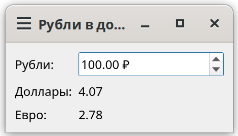

# Перевод валют на 31.12.2007 (рубль -> доллар; рубль -> евро)
Данное приложение создано для того, чтобы можно было понастальгировать и поплакать, глядя на курс 2007 года, когда рубль стоил 24.5 рублей, а евро 35.9

## Функционал программы 
 

## Изменения в коде
__cl2__  
Сигнал перенесён внутрь класса Cl2(QObject) 

__cl1__ 
Функция func() больше не создаёт объект Data сама.Теперь объект data передаётся в func() аргументом: def func(data). Функция лишь вызывает data.getData() у того объекта, который ей передали.
 
__main__ 

В окно добавлен полноценный интерфейс: QDoubleSpinBox для рублей, QLabel для долларов и евро, компоновка QFormLayout и заголовок окна.

Some._init _ теперь принимает data и создаёт экземпляры cl1.Cl1() и cl2.Cl2().

Сигналы cl1.mySignal и cl2.mySignal подключены к слотам, обновляющим метки 

Добавлен слот onRub: по сигналу rub.valueChanged он считает rub / rates["USD"] и rub / rates["EUR"] и выдает результаты через сигналы Cl1 и Cl2.

Data.myData теперь словарь с курсами: {"USD": 24.5462, "EUR": 35.9332}.

В __main __ порядок исправлен: сначала data = Data(), затем cl1.func(data), затем окно Some(data) — зависимости передаются явно.

